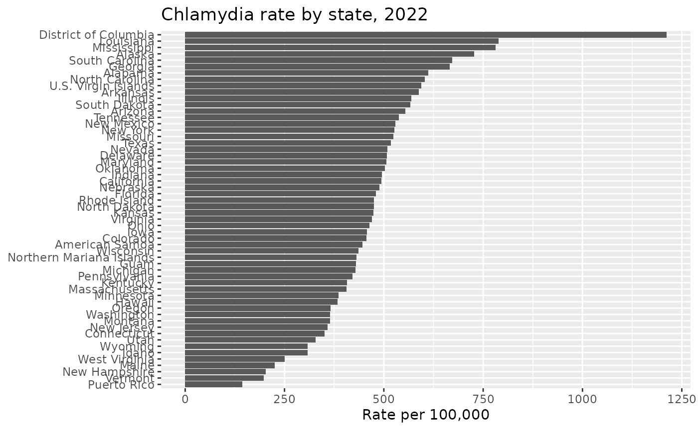
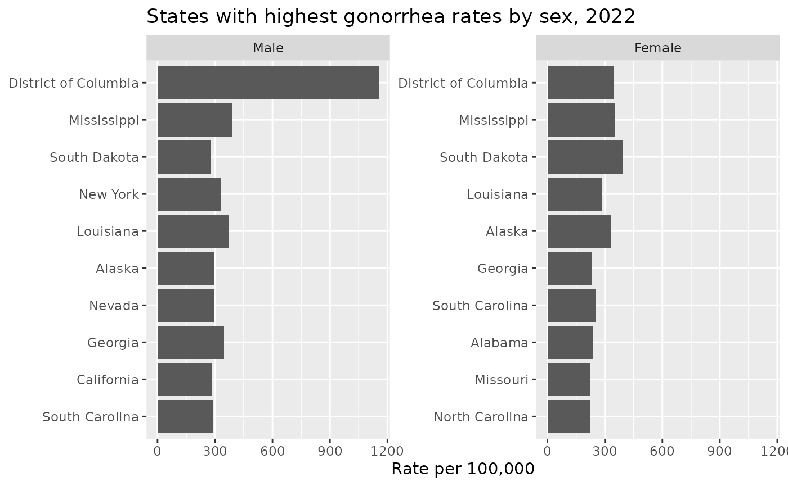
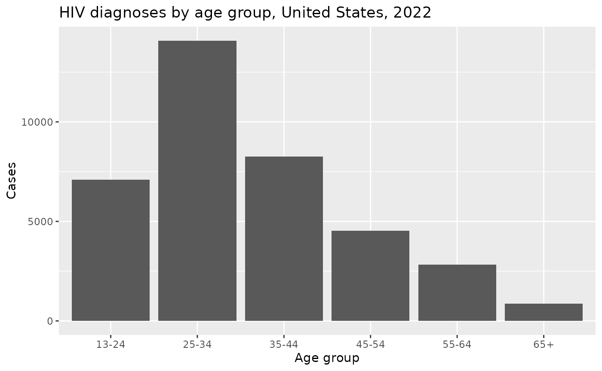
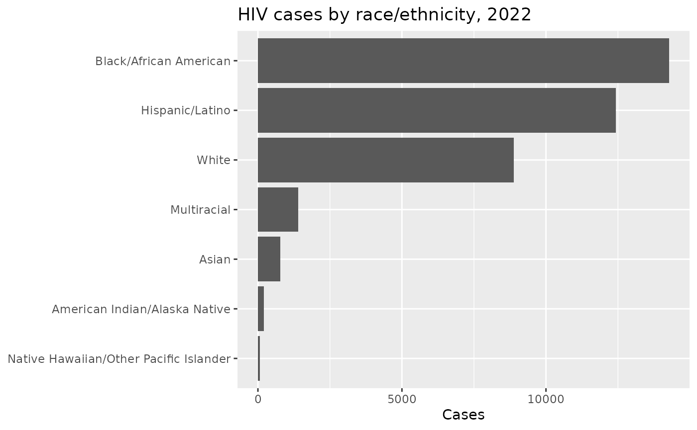
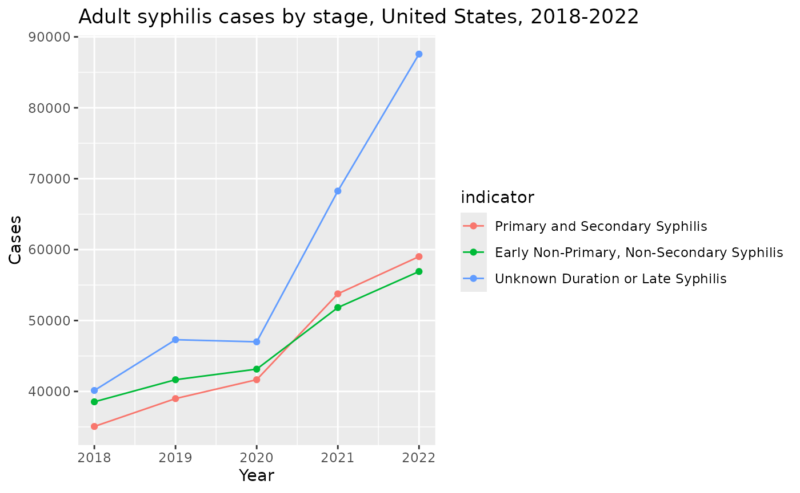
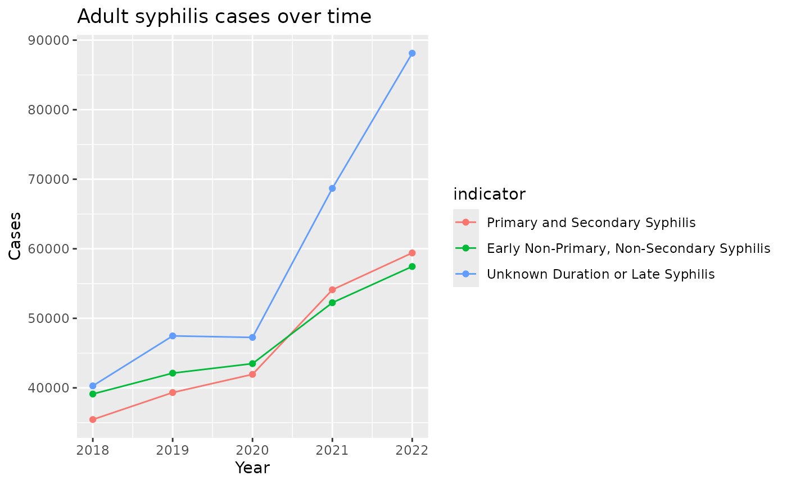

# Getting started with CDCAtlas

**CDCAtlas** provides R functions for retrieving public health
surveillance data from CDC AtlasPlus.

This article introduces common use patterns:

- retrieving state- and county-level data
- querying different diseases
- using sex, age, and race/ethnicity stratification
- comparing rates across groups
- preparing AtlasPlus data for plotting and analysis

This article does **not** cover tract-level extrapolation. That is an
advanced use case covered in [Extrapolation to
tracts](https://vagishhemmige.github.io/CDCAtlas/articles/extrapolation.md).

## Installation

``` r

# install.packages("remotes")
remotes::install_github("VagishHemmige/CDCAtlas")
```

## Setup

``` r

library(CDCAtlas)
library(dplyr)
library(ggplot2)
```

## Basic query: state-level chlamydia data

A simple query retrieves one disease, one geography level, and one year.

``` r

chlamydia_state <- get_atlas(
  disease   = "chlamydia",
  geography = "state",
  year      = 2022
)

head(chlamydia_state)
#> # A tibble: 6 × 17
#>   indicator  year geography  data_status race_ethnicity sex   age   transmission
#>   <fct>     <dbl> <fct>      <fct>       <fct>          <fct> <fct> <fct>       
#> 1 Chlamydia  2022 Alabama    Not Suppre… All races/eth… Both… All … All transmi…
#> 2 Chlamydia  2022 Alaska     Not Suppre… All races/eth… Both… All … All transmi…
#> 3 Chlamydia  2022 Arizona    Not Suppre… All races/eth… Both… All … All transmi…
#> 4 Chlamydia  2022 Arkansas   Not Suppre… All races/eth… Both… All … All transmi…
#> 5 Chlamydia  2022 California Not Suppre… All races/eth… Both… All … All transmi…
#> 6 Chlamydia  2022 Colorado   Not Suppre… All races/eth… Both… All … All transmi…
#> # ℹ 9 more variables: rate100000 <dbl>, cases <dbl>, population <dbl>,
#> #   lowerci_rate <dbl>, upperci_rate <dbl>, rse <dbl>, lowerci_cases <dbl>,
#> #   upperci_cases <dbl>, fips <chr>
```

The returned object is a data frame that can be used directly with
tidyverse tools.

``` r

glimpse(chlamydia_state)
#> Rows: 57
#> Columns: 17
#> $ indicator      <fct> Chlamydia, Chlamydia, Chlamydia, Chlamydia, Chlamydia, …
#> $ year           <dbl> 2022, 2022, 2022, 2022, 2022, 2022, 2022, 2022, 2022, 2…
#> $ geography      <fct> Alabama, Alaska, Arizona, Arkansas, California, Colorad…
#> $ data_status    <fct> Not Suppressed, Not Suppressed, Not Suppressed, Not Sup…
#> $ race_ethnicity <fct> All races/ethnicities, All races/ethnicities, All races…
#> $ sex            <fct> Both sexes, Both sexes, Both sexes, Both sexes, Both se…
#> $ age            <fct> All age groups, All age groups, All age groups, All age…
#> $ transmission   <fct> All transmission categories, All transmission categorie…
#> $ rate100000     <dbl> 612.1, 727.7, 554.4, 588.3, 493.6, 456.3, 143.8, 593.9,…
#> $ cases          <dbl> 31060, 5338, 40796, 17918, 192647, 26646, 4633, 626, NA…
#> $ population     <dbl> 5074296, 733583, 7359197, 3045637, 39029342, 5839926, 3…
#> $ lowerci_rate   <dbl> NA, NA, NA, NA, NA, NA, NA, NA, NA, NA, NA, NA, NA, NA,…
#> $ upperci_rate   <dbl> NA, NA, NA, NA, NA, NA, NA, NA, NA, NA, NA, NA, NA, NA,…
#> $ rse            <dbl> NA, NA, NA, NA, NA, NA, NA, NA, NA, NA, NA, NA, NA, NA,…
#> $ lowerci_cases  <dbl> NA, NA, NA, NA, NA, NA, NA, NA, NA, NA, NA, NA, NA, NA,…
#> $ upperci_cases  <dbl> NA, NA, NA, NA, NA, NA, NA, NA, NA, NA, NA, NA, NA, NA,…
#> $ fips           <chr> "01", "02", "04", "05", "06", "08", "72", "78", "70", "…
```

## Plot state-level rates

``` r

chlamydia_state |>
  filter(!is.na(rate100000)) |>
  ggplot(aes(x = reorder(geography, rate100000), y = rate100000)) +
  geom_col() +
  coord_flip() +
  labs(
    title = "Chlamydia rate by state, 2022",
    x = NULL,
    y = "Rate per 100,000"
  )
```



## Query county-level data

AtlasPlus can also return county-level data for supported diseases.

``` r

chlamydia_county <- get_atlas(
  disease   = "chlamydia",
  geography = "county",
  year      = 2022
)

head(chlamydia_county)
#> # A tibble: 6 × 17
#>   indicator  year geography  data_status race_ethnicity sex   age   transmission
#>   <fct>     <dbl> <fct>      <fct>       <fct>          <fct> <fct> <fct>       
#> 1 Chlamydia  2022 Autauga C… Not Suppre… All races/eth… Both… All … All transmi…
#> 2 Chlamydia  2022 Baldwin C… Not Suppre… All races/eth… Both… All … All transmi…
#> 3 Chlamydia  2022 Barbour C… Not Suppre… All races/eth… Both… All … All transmi…
#> 4 Chlamydia  2022 Bibb Coun… Not Suppre… All races/eth… Both… All … All transmi…
#> 5 Chlamydia  2022 Blount Co… Not Suppre… All races/eth… Both… All … All transmi…
#> 6 Chlamydia  2022 Bullock C… Not Suppre… All races/eth… Both… All … All transmi…
#> # ℹ 9 more variables: rate100000 <dbl>, cases <dbl>, population <dbl>,
#> #   lowerci_rate <dbl>, upperci_rate <dbl>, rse <dbl>, lowerci_cases <dbl>,
#> #   upperci_cases <dbl>, fips <chr>
```

A common workflow is to identify counties with the highest reported
rates.

``` r

chlamydia_county |>
  filter(!is.na(rate100000)) |>
  arrange(desc(rate100000)) |>
  select(geography, cases, rate100000) |>
  head(10)
#> # A tibble: 10 × 3
#>    geography                    cases rate100000
#>    <fct>                        <dbl>      <dbl>
#>  1 Reeves County, TX              552      4277.
#>  2 Todd County, SD                340      3688.
#>  3 Kusilvak Census Area, AK       287      3467 
#>  4 Dewey County, SD               174      3385.
#>  5 Bethel Census Area, AK         528      2892 
#>  6 Nome Census Area, AK           281      2857.
#>  7 Oglala Lakota County, SD       359      2656.
#>  8 Mellette County, SD             40      2114.
#>  9 Northwest Arctic Borough, AK   150      2021.
#> 10 Tunica County, MS              186      1967.
```

## Stratification by sex

Many AtlasPlus endpoints support stratification. For example, we can
retrieve state-level gonorrhea data by sex.

``` r

gonorrhea_sex <- get_atlas(
  disease   = "gonorrhea",
  geography = "state",
  year      = 2022,
  stratify_by = "sex"
)

head(gonorrhea_sex)
#> # A tibble: 6 × 17
#>   indicator  year geography data_status  race_ethnicity sex   age   transmission
#>   <fct>     <dbl> <fct>     <fct>        <fct>          <fct> <fct> <fct>       
#> 1 Gonorrhea  2022 Alabama   Not Suppres… All races/eth… Male  All … All transmi…
#> 2 Gonorrhea  2022 Alabama   Not Suppres… All races/eth… Fema… All … All transmi…
#> 3 Gonorrhea  2022 Alaska    Not Suppres… All races/eth… Male  All … All transmi…
#> 4 Gonorrhea  2022 Alaska    Not Suppres… All races/eth… Fema… All … All transmi…
#> 5 Gonorrhea  2022 Arizona   Not Suppres… All races/eth… Male  All … All transmi…
#> 6 Gonorrhea  2022 Arizona   Not Suppres… All races/eth… Fema… All … All transmi…
#> # ℹ 9 more variables: rate100000 <dbl>, cases <dbl>, population <dbl>,
#> #   lowerci_rate <dbl>, upperci_rate <dbl>, rse <dbl>, lowerci_cases <dbl>,
#> #   upperci_cases <dbl>, fips <chr>
```

Now we can compare rates by sex within each state.

``` r

gonorrhea_sex |>
  filter(!is.na(rate100000)) |>
  group_by(sex) |>
  slice_max(rate100000, n = 10, with_ties = FALSE) |>
  ungroup() |>
  ggplot(aes(x = reorder(geography, rate100000), y = rate100000)) +
  geom_col() +
  coord_flip() +
  facet_wrap(~ sex, scales = "free_y") +
  labs(
    title = "States with highest gonorrhea rates by sex, 2022",
    x = NULL,
    y = "Rate per 100,000"
  )
```



## Stratification by age

AtlasPlus also supports age-stratified queries for many
disease/geography combinations.

``` r

hiv_age <- get_atlas(
  disease   = "hiv",
  geography = "state",
  year      = 2022,
  stratify_by = "age"

)

head(hiv_age)
#> # A tibble: 6 × 17
#>   indicator   year geography data_status race_ethnicity sex   age   transmission
#>   <fct>      <dbl> <fct>     <fct>       <fct>          <fct> <fct> <fct>       
#> 1 HIV diagn…  2022 Alabama   Not Suppre… All races/eth… Both… 13-24 All transmi…
#> 2 HIV diagn…  2022 Alabama   Not Suppre… All races/eth… Both… 25-34 All transmi…
#> 3 HIV diagn…  2022 Alabama   Not Suppre… All races/eth… Both… 35-44 All transmi…
#> 4 HIV diagn…  2022 Alabama   Not Suppre… All races/eth… Both… 45-54 All transmi…
#> 5 HIV diagn…  2022 Alabama   Not Suppre… All races/eth… Both… 55-64 All transmi…
#> 6 HIV diagn…  2022 Alabama   Not Suppre… All races/eth… Both… 65+   All transmi…
#> # ℹ 9 more variables: rate100000 <dbl>, cases <dbl>, population <dbl>,
#> #   lowerci_rate <dbl>, upperci_rate <dbl>, rse <dbl>, lowerci_cases <dbl>,
#> #   upperci_cases <dbl>, fips <chr>
```

We can summarize national patterns by aggregating across states.

``` r

hiv_age_summary <- hiv_age |>
  group_by(age, indicator) |>
  summarize(
    cases = sum(cases, na.rm = TRUE),
    .groups = "drop"
  )

hiv_age_summary
#> # A tibble: 12 × 3
#>    age   indicator       cases
#>    <fct> <fct>           <dbl>
#>  1 13-24 HIV diagnoses    7151
#>  2 13-24 HIV prevalence  28335
#>  3 25-34 HIV diagnoses   14200
#>  4 25-34 HIV prevalence 166715
#>  5 35-44 HIV diagnoses    8340
#>  6 35-44 HIV prevalence 211977
#>  7 45-54 HIV diagnoses    4595
#>  8 45-54 HIV prevalence 237860
#>  9 55-64 HIV diagnoses    2861
#> 10 55-64 HIV prevalence 295885
#> 11 65+   HIV diagnoses     889
#> 12 65+   HIV prevalence 162026
```

``` r

hiv_age_summary |>
  filter(indicator=="HIV diagnoses")|>
  ggplot(mapping=aes(x = age, y = cases)) +
  geom_col() +
  labs(
    title = "HIV diagnoses by age group, 2022",
    x = "Age group",
    y = "Cases"
  )
```



## Stratification by race/ethnicity

CDC AtlasPlus commonly uses a combined race/ethnicity variable rather
than separate race and Hispanic ethnicity fields.

``` r

hiv_race <- get_atlas(
  disease        = "hiv",
  geography      = "state",
  year           = 2022,
  stratify_by = "race"

)

head(hiv_race)
#> # A tibble: 6 × 17
#>   indicator   year geography data_status race_ethnicity sex   age   transmission
#>   <fct>      <dbl> <fct>     <fct>       <fct>          <fct> <fct> <fct>       
#> 1 HIV diagn…  2022 Alabama   Not Suppre… American Indi… Both… Ages… All transmi…
#> 2 HIV diagn…  2022 Alaska    Not Suppre… American Indi… Both… Ages… All transmi…
#> 3 HIV diagn…  2022 Arizona   Not Suppre… American Indi… Both… Ages… All transmi…
#> 4 HIV diagn…  2022 Arkansas  Not Suppre… American Indi… Both… Ages… All transmi…
#> 5 HIV diagn…  2022 Californ… Not Suppre… American Indi… Both… Ages… All transmi…
#> 6 HIV diagn…  2022 Colorado  Not Suppre… American Indi… Both… Ages… All transmi…
#> # ℹ 9 more variables: rate100000 <dbl>, cases <dbl>, population <dbl>,
#> #   lowerci_rate <dbl>, upperci_rate <dbl>, rse <dbl>, lowerci_cases <dbl>,
#> #   upperci_cases <dbl>, fips <chr>
```

A useful first look is to compare total reported cases by
race/ethnicity.

``` r

hiv_race_summary <- hiv_race |>
  group_by(race_ethnicity, indicator) |>
  summarize(
    cases = sum(cases, na.rm = TRUE),
    .groups = "drop"
  ) |>
  arrange(desc(cases))

hiv_race_summary
#> # A tibble: 14 × 3
#>    race_ethnicity                         indicator       cases
#>    <fct>                                  <fct>           <dbl>
#>  1 Black/African American                 HIV prevalence 427114
#>  2 White                                  HIV prevalence 301263
#>  3 Hispanic/Latino                        HIV prevalence 287669
#>  4 Multiracial                            HIV prevalence  65407
#>  5 Asian                                  HIV prevalence  16821
#>  6 Black/African American                 HIV diagnoses   14277
#>  7 Hispanic/Latino                        HIV diagnoses   12428
#>  8 White                                  HIV diagnoses    8878
#>  9 American Indian/Alaska Native          HIV prevalence   3034
#> 10 Multiracial                            HIV diagnoses    1402
#> 11 Native Hawaiian/Other Pacific Islander HIV prevalence    877
#> 12 Asian                                  HIV diagnoses     773
#> 13 American Indian/Alaska Native          HIV diagnoses     206
#> 14 Native Hawaiian/Other Pacific Islander HIV diagnoses      72
```

``` r


hiv_race_summary |>
  filter(indicator=="HIV diagnoses")|>
  ggplot(mapping =aes(x = reorder(race_ethnicity, cases), y = cases)) +
  geom_col() +
  coord_flip() +
  labs(
    title = "HIV cases by race/ethnicity, 2022",
    x = NULL,
    y = "Cases"
  )
```



## Multiple stratification variables

You can request combinations of stratification variables when supported
by the underlying AtlasPlus endpoint. For example, HIV data can be
queried by both sex and age.

``` r

hiv_age_sex <- get_atlas(
  disease   = "hiv",
  geography = "state",
  year      = 2022,
  stratify_by = c("sex", "age")

)

head(hiv_age_sex)
#> # A tibble: 6 × 17
#>   indicator   year geography data_status race_ethnicity sex   age   transmission
#>   <fct>      <dbl> <fct>     <fct>       <fct>          <fct> <fct> <fct>       
#> 1 HIV diagn…  2022 Alabama   Not Suppre… All races/eth… Male  13-24 All transmi…
#> 2 HIV diagn…  2022 Alabama   Not Suppre… All races/eth… Male  25-34 All transmi…
#> 3 HIV diagn…  2022 Alabama   Not Suppre… All races/eth… Male  35-44 All transmi…
#> 4 HIV diagn…  2022 Alabama   Not Suppre… All races/eth… Male  45-54 All transmi…
#> 5 HIV diagn…  2022 Alabama   Not Suppre… All races/eth… Male  55-64 All transmi…
#> 6 HIV diagn…  2022 Alabama   Not Suppre… All races/eth… Male  65+   All transmi…
#> # ℹ 9 more variables: rate100000 <dbl>, cases <dbl>, population <dbl>,
#> #   lowerci_rate <dbl>, upperci_rate <dbl>, rse <dbl>, lowerci_cases <dbl>,
#> #   upperci_cases <dbl>, fips <chr>
```

This allows direct comparison of age distributions by sex.

``` r

hiv_age_sex_summary <- hiv_age_sex |>
  group_by(sex, age, indicator) |>
  summarize(
    cases = sum(cases, na.rm = TRUE),
    .groups = "drop"
  )

hiv_age_sex_summary
#> # A tibble: 24 × 4
#>    sex   age   indicator       cases
#>    <fct> <fct> <fct>           <dbl>
#>  1 Male  13-24 HIV diagnoses    6283
#>  2 Male  13-24 HIV prevalence  22927
#>  3 Male  25-34 HIV diagnoses   12143
#>  4 Male  25-34 HIV prevalence 141428
#>  5 Male  35-44 HIV diagnoses    6534
#>  6 Male  35-44 HIV prevalence 164437
#>  7 Male  45-54 HIV diagnoses    3346
#>  8 Male  45-54 HIV prevalence 172026
#>  9 Male  55-64 HIV diagnoses    2076
#> 10 Male  55-64 HIV prevalence 226017
#> # ℹ 14 more rows
```

``` r

hiv_age_sex_summary |>
  filter(indicator=="HIV diagnoses")|>
  ggplot(aes(x = age, y = cases)) +
  geom_col() +
  facet_wrap(~ sex) +
  labs(
    title = "HIV cases by age and sex, 2022",
    x = "Age group",
    y = "Cases"
  )
```



## Comparing years

You can also query multiple years and compare trends over time.

``` r

syphilis_years <- get_atlas(
  disease   = "adult syphilis",
  geography = "state",
  year      = 2018:2022
)

head(syphilis_years)
#> # A tibble: 6 × 17
#>   indicator   year geography data_status race_ethnicity sex   age   transmission
#>   <fct>      <dbl> <fct>     <fct>       <fct>          <fct> <fct> <fct>       
#> 1 Primary a…  2018 Alabama   Not Suppre… All races/eth… Both… All … All transmi…
#> 2 Primary a…  2019 Alabama   Not Suppre… All races/eth… Both… All … All transmi…
#> 3 Primary a…  2020 Alabama   Not Suppre… All races/eth… Both… All … All transmi…
#> 4 Primary a…  2021 Alabama   Not Suppre… All races/eth… Both… All … All transmi…
#> 5 Primary a…  2022 Alabama   Not Suppre… All races/eth… Both… All … All transmi…
#> 6 Primary a…  2018 Alaska    Not Suppre… All races/eth… Both… All … All transmi…
#> # ℹ 9 more variables: rate100000 <dbl>, cases <dbl>, population <dbl>,
#> #   lowerci_rate <dbl>, upperci_rate <dbl>, rse <dbl>, lowerci_cases <dbl>,
#> #   upperci_cases <dbl>, fips <chr>
```

For example, compare national totals by year.

``` r

syphilis_trend <- syphilis_years |>
  group_by(year, indicator) |>
  summarize(
    cases = sum(cases, na.rm = TRUE),
    .groups = "drop"
  )

syphilis_trend
#> # A tibble: 15 × 3
#>     year indicator                                 cases
#>    <dbl> <fct>                                     <dbl>
#>  1  2018 Primary and Secondary Syphilis            35447
#>  2  2018 Early Non-Primary, Non-Secondary Syphilis 39119
#>  3  2018 Unknown Duration or Late Syphilis         40285
#>  4  2019 Primary and Secondary Syphilis            39327
#>  5  2019 Early Non-Primary, Non-Secondary Syphilis 42118
#>  6  2019 Unknown Duration or Late Syphilis         47473
#>  7  2020 Primary and Secondary Syphilis            41942
#>  8  2020 Early Non-Primary, Non-Secondary Syphilis 43486
#>  9  2020 Unknown Duration or Late Syphilis         47256
#> 10  2021 Primary and Secondary Syphilis            54108
#> 11  2021 Early Non-Primary, Non-Secondary Syphilis 52247
#> 12  2021 Unknown Duration or Late Syphilis         68691
#> 13  2022 Primary and Secondary Syphilis            59404
#> 14  2022 Early Non-Primary, Non-Secondary Syphilis 57450
#> 15  2022 Unknown Duration or Late Syphilis         88121
```

``` r

syphilis_trend |>
ggplot(mapping= aes(x = year, y = cases, color=indicator, group=indicator)) +
  geom_line() +
  geom_point() +
  labs(
    title = "Adult syphilis cases over time",
    x = "Year",
    y = "Cases"
  )
```



## Working with censored or missing values

CDC AtlasPlus may suppress or censor some values, especially for small
counts. Depending on the disease and geography, `cases` or `rate100000`
may be missing.

A common first step is to inspect missingness.

``` r

chlamydia_county |>
  summarize(
    n_rows = n(),
    missing_cases = sum(is.na(cases)),
    missing_rates = sum(is.na(rate100000))
  )
#> # A tibble: 1 × 3
#>   n_rows missing_cases missing_rates
#>    <int>         <int>         <int>
#> 1   3231            19            19
```

## Choosing diseases and stratification variables

The available diseases and stratification variables depend on CDC
AtlasPlus. Common disease values include:

``` r

get_atlas(disease = "hiv", geography = "state", year = 2022)
get_atlas(disease = "chlamydia", geography = "state", year = 2022)
get_atlas(disease = "gonorrhea", geography = "state", year = 2022)
get_atlas(disease = "adult syphilis", geography = "state", year = 2022)
get_atlas(disease = "tuberculosis", geography = "state", year = 2022)
```

## Next steps

After getting comfortable with basic queries, consider:

- querying multiple diseases
- comparing state and county results
- using sex, age, and race/ethnicity stratification
- joining AtlasPlus data to Census or spatial data
- tract-level extrapolation ([Extrapolation to
  tracts](https://vagishhemmige.github.io/CDCAtlas/articles/extrapolation.md))

See
[`?get_atlas`](https://vagishhemmige.github.io/CDCAtlas/reference/get_atlas.md)
for full argument documentation.
